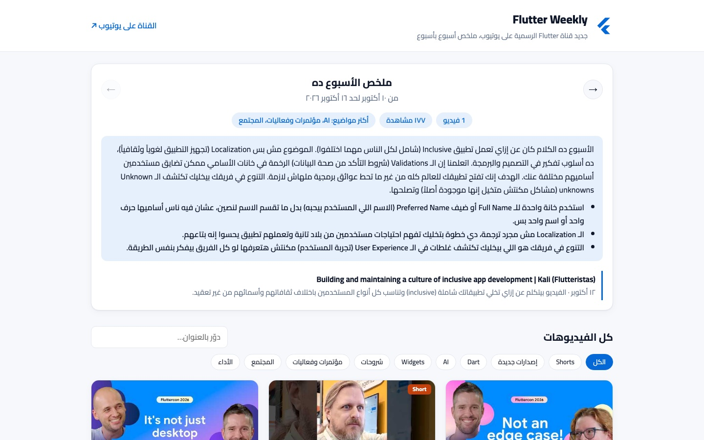

<h1 align="center">Flutter Weekly</h1>

<p align="center">
  A self-updating Arabic digest of the official Flutter YouTube channel: one summary per video, one recap per week.
</p>

<p align="center">
  <a href="https://youssef336.github.io/flutter-weekly/"></a>
  
  
  
  
</p>

<p align="center">
  
  <br/><sub>Live site: weekly summary and video list</sub>
</p>

> **English summary.** Flutter Weekly is a static site (HTML + CSS + vanilla JS) that follows the
> official [@flutterdev](https://www.youtube.com/@flutterdev/videos) channel. A daily GitHub Actions job
> runs two standard-library-only Python scripts: one reads the channel's RSS feed, auto-tags each video
> and merges it into `data/videos.json`; the other sends every new video to the **Gemini API**, which
> watches it from its YouTube URL and writes a junior-friendly Egyptian-Arabic summary (what it's about,
> 3–5 key points, whether it's worth watching, and a mini glossary), plus a weekly recap. The site,
> served from GitHub Pages, shows the week's digest with navigation to past weeks and a searchable,
> filterable grid of every video.

**🔗 الموقع:** https://youssef336.github.io/flutter-weekly/

<div dir="rtl">

موقع بسيط بيتابع قناة يوتيوب الرسمية لـ Flutter
([@flutterdev](https://www.youtube.com/@flutterdev/videos)) ويلخّصلك الجديد بالعربي المصري، بلغة
تناسب حد لسه junior.

## ✨ فيه إيه

- 📅 **ملخص الأسبوع** (من السبت للجمعة): عدد الفيديوهات، والمشاهدات، وأكتر المواضيع، وسطر لكل فيديو،
  وفقرة بأهم اللي حصل في الأسبوع ونقط عملية تستاهل تعرفها. وتقدر ترجع للأسابيع اللي فاتت.
- 🎬 **كل الفيديوهات**: كروت بالصورة والتاريخ والملخص، مع فلتر بالتصنيف (إصدارات، Dart، AI، Widgets،
  Tutorials، Events، Performance، Web، Games …) وبحث جوه العناوين والملخصات.
- 🤖 **ملخص لكل فيديو**: الفيديو عن إيه، ومن 3 لـ 5 نقط بأهم اللي اتقال، ويهمك ولا لأ، و📘 مصطلحات
  بشرح بسيط للكلمات اللي ممكن متكونش عارفها.
- 🔄 **بيحدّث نفسه** كل يوم من غير ما حد يلمسه.

## ⚙️ بيشتغل إزاي

- `scripts/fetch.py` (Python من غير أي مكتبات خارجية) بيقرا RSS القناة، وبيطلّع ملخص قصير من وصف كل
  فيديو ويصنّفه، ويدمجه في `data/videos.json` (القديم بيفضل محفوظ، لأن الـ RSS بيرجّع آخر 15 فيديو بس).
- `scripts/summarize.py` بيبعت كل فيديو جديد لـ **Gemini** (بيتفرج على الفيديو نفسه من لينك يوتيوب)
  ويكتب الملخص بالعربي، وبعدين بيكتب ملخص لكل أسبوع. لو الفيديو منفعش، بيلخّص من العنوان والوصف
  وبيكتب كده جنب الملخص.
- `.github/workflows/update.yml` بيشغّل الاتنين كل يوم الساعة 8 الصبح UTC، ويعمل commit بس لو فيه
  فيديوهات جديدة فعلًا.
- الموقع static على GitHub Pages وبيقرا `data/videos.json`.

## 🔑 مفتاح Gemini

خد مفتاح مجاني من [Google AI Studio](https://aistudio.google.com/apikey) وحطه كـ secret:

```bash
gh secret set GEMINI_API_KEY -R youssef336/flutter-weekly
```

ولو عايز موديل معيّن:

```bash
gh variable set GEMINI_MODEL -R youssef336/flutter-weekly --body gemini-2.5-flash
```

## 🚀 تشغيل local

```bash
python3 scripts/fetch.py                          # تحديث البيانات
GEMINI_API_KEY=... python3 scripts/summarize.py   # الملخصات
python3 -m http.server 8000                       # وافتح http://localhost:8000
```

</div>

## 🛠 Tech stack

- **Frontend:** HTML, CSS and vanilla JavaScript; no framework, no build step.
- **Data pipeline:** Python 3 (standard library only): YouTube RSS → `data/videos.json`.
- **Summaries:** Gemini API (`generateContent` with structured JSON output); model falls back through a list unless `GEMINI_MODEL` is set.
- **Automation & hosting:** GitHub Actions (daily cron + manual run) and GitHub Pages.

## 🏗 Project structure

```text
├── index.html
├── css/style.css
├── js/app.js                    # week view, filters, search, video cards
├── data/videos.json             # videos + AI summaries + weekly digests
├── scripts/
│   ├── fetch.py                 # RSS → videos.json, tagging
│   └── summarize.py             # Gemini summaries (per video + per week)
└── .github/workflows/update.yml # daily update job
```

## 👤 Author

**Youssef Belal Zakaria** · [GitHub @youssef336](https://github.com/youssef336)

⭐ If you like this project, give it a star!
